::: {custom-style="Portada"}
Universidad Nacional de Tucumán

Facultad de Ciencias Exactas y Tecnología

[COMPLETAR: logos de la UNT, la FACET y la EITI]

Especialización en Integración de Tecnologías Informáticas

Trabajo Final Integrador

Sistema de Gestión para Altacava Winebar

Autor: Llanes, Adrian

Tutor: Mg. Ing. Volentini, Esteban

Tutor externo: Esp. Ing. Tek, Luis

[COMPLETAR: mes y año de presentación]
:::

```{=openxml}
<w:p><w:r><w:br w:type="page"/></w:r></w:p>
```

::: {custom-style="TituloSinNumero"}
Resumen
:::

En este documento se describe el diseño y la implementación de una aplicación web para gestionar las ventas de un bar de vinos y tapas de modalidad autoservicio: Altacava Winebar. En el bar, cada cliente recibe al ingresar una tarjeta RFID con la que realiza todos sus consumos y que devuelve al retirarse, momento en el que se le cobra. Los vinos son servidos por máquinas dispensadoras automáticas marca Vitte, que el mismo cliente activa con su tarjeta, mientras que las tapas son despachadas por personal en un puesto de atención.

El sistema desarrollado reutiliza las tarjetas que exigen las dispensadoras para identificar a los clientes y al personal en todas las operaciones del bar, consolida en una única orden de compra los consumos de vino y de tapas, limita el gasto de cada cliente mediante montos máximos, administra los turnos de caja y permite cobrar en caja o imputar el consumo al aplicativo gastronómico Fudo. La solución está compuesta por un *backend* con una API REST, una base de datos relacional, un *frontend* web con una vista para cada rol y un pequeño servidor local que se ejecuta en cada terminal, todo ello desplegado mediante contenedores en la red local del bar.

Para llevar a cabo el trabajo se integraron conocimientos adquiridos a lo largo de la especialización, en particular técnicas de gestión de proyectos e ingeniería de software, diseño de bases de datos relacionales, programación orientada a objetos, redes e integración con sistemas de terceros.

```{=openxml}
<w:p><w:r><w:br w:type="page"/></w:r></w:p>
```

::: {custom-style="TituloSinNumero"}
Tabla de contenido
:::

```{=openxml}
<w:p><w:r><w:fldChar w:fldCharType="begin" w:dirty="true"/></w:r><w:r><w:instrText xml:space="preserve"> TOC \o "1-3" \h \z \u </w:instrText></w:r><w:r><w:fldChar w:fldCharType="separate"/></w:r><w:r><w:t>Actualizar el campo (F9) para generar la tabla de contenido.</w:t></w:r><w:r><w:fldChar w:fldCharType="end"/></w:r></w:p>
```


# 1. Introducción general

En este capítulo se presenta el problema que dio origen al trabajo, las soluciones existentes en el mercado, la motivación del proyecto y los objetivos y el alcance definidos.

## 1.1. Descripción del problema

Altacava Winebar es un bar de vinos y tapas que funciona bajo una modalidad de autoservicio. Su propuesta fue pensada alrededor de máquinas dispensadoras de vino de la firma Vitte, de industria nacional, que permiten que el propio cliente se sirva una medida de vino al acercarles una tarjeta RFID. Estas dispensadoras forman parte de un sistema cerrado, provisto por el fabricante, que solo resuelve la venta de vino: registra clientes, tarjetas, saldos y consumos en una nube propia, pero no contempla la venta de otros productos ni la operatoria de caja de un comercio gastronómico.

El cliente del proyecto deseaba poder usar la misma tarjeta para todo lo que ocurre dentro del bar. En particular, esto significaba que:

- Al ingresar, cada persona recibiera una tarjeta asociada a su nombre
- Un cliente, con su tarjeta, pudiera servirse vino en las dispensadoras y pedir tapas en un puesto de despacho; sin pagar en cada consumo
- Un cliente, al retirarse, devolviera la tarjeta y abonara en la caja la suma de todos sus consumos
- El personal del bar (cajeros, despachantes de tapas y administradores) también se pudiera identificar, cada uno con su tarjeta
- Quedara registro de los turnos de caja, de lo cobrado en cada uno y de quién atendió cada operación.

Con esto, el problema consistió en construir un sistema de gestión alrededor de dos elementos que ya estaban definidos de antemano: las tarjetas RFID y las máquinas dispensadoras Vitte. El principal desafío técnico fue la integración con la nube de Vitte, ya que el sistema del bar debía dar de alta a los clientes en ella, asignarles saldo, recuperar sus consumos de vino y darlos de baja al cierre, de manera transparente para el cajero.

## 1.2. Estado del arte

[COMPLETAR/REVISAR: esta sección fue redactada a partir de conocimiento general y de lo que se desprende del proyecto. Conviene validar los productos mencionados y agregar las referencias que el tutor considere pertinentes.]

Los sistemas de gestión para locales gastronómicos disponibles en el mercado local se organizan, en general, alrededor del concepto de mesa: un mozo toma un pedido, lo carga en una mesa, la cocina recibe una comanda y la cuenta se cierra por mesa. A esta categoría pertenece Fudo, el sistema que utiliza el restaurante vinculado a Altacava y con el que este trabajo terminó integrándose. Estos productos resuelven adecuadamente la facturación, el control de stock y los reportes, pero no contemplan un esquema en el que cada persona acumula consumos individuales mediante una credencial propia.

Por otro lado, los sistemas de autoservicio de bebidas, entre los que se encuentra Vitte, ofrecen su propia plataforma de administración. En ella se gestionan clientes, tarjetas, saldos, vinos, precios y reportes de consumo. En este caso, la modalidad es de saldo prepago: un cliente carga dinero en su tarjeta y lo va consumiendo. Estas plataformas están pensadas para manejar las máquinas, y no para gestionar el resto de las ventas de un local.

Finalmente, existen soluciones de pago sin efectivo (*cashless*) orientadas a eventos masivos, basadas en pulseras o tarjetas RFID o NFC. Estas soluciones comparten el concepto de credencial única por persona, pero están dirigidas a otro tipo de operación y tampoco se integran con las dispensadoras utilizadas.

Ninguna de las alternativas relevadas cubría el caso de uso completo: una cuenta individual pospaga, identificada por la misma tarjeta que acciona las dispensadoras, que combine los consumos de vino registrados por un sistema de terceros, con consumos de tapas registrados por el personal del bar.

## 1.3. Motivación

El cliente tiene como proyecto a mediano y largo plazo una cadena de bares de vino bajo este mismo formato. Para ello necesitaba un sistema a medida que le permitiera gestionar el primer local y que pudiera eventualmente evolucionar.

Desde el punto de vista académico, el proyecto resultó de interés porque obliga a integrar tecnologías de distinta naturaleza: una aplicación web, una base de datos relacional, dispositivos RFID, una computadora de placa única (SBC) con periféricos, y dos sistemas externos con los que se debe interactuar.

## 1.4. Objetivos y alcance


### 1.4.1. Objetivos

El objetivo general del trabajo es desarrollar un sistema de gestión de ventas para un bar de tapas y vinos de tipo fast-food, *Altacava Winebar*, que utiliza máquinas dispensadoras de vino Vitte de industria nacional.

Los objetivos específicos son:

- Desarrollar una aplicación en formato web que permita gestionar las ventas del bar.
- Investigar el funcionamiento de la API del sistema de dispensadoras de vino para integrarlo en el proyecto.
- Reutilizar las tarjetas RFID requeridas por las dispensadoras para todas las operaciones en el bar.
- Implementar una base de datos robusta.
- Redactar un informe explicativo del funcionamiento del sistema propuesto.

A largo plazo, el proyecto del cliente apunta a gestionar varias sucursales. Esta memoria describe la primera etapa: la versión funcional del sistema para un único local.

### 1.4.2. Alcance

Los usuarios del sistema son el personal interno del bar, clasificados en tres roles: Administrador, Cajero y Tapero. El administrador configura el sistema, da de alta tarjetas, personal y tapas, define los montos máximos de consumo y consulta los turnos y las órdenes. El cajero abre y cierra los turnos de caja, registra el ingreso de cada cliente, consulta las órdenes en curso y las cobra. Por último, el tapero atiende el puesto de tapas y carga los pedidos de los clientes.

Los clientes del bar no operan la aplicación de manera directa: interactúan con el sistema únicamente a través de su tarjeta, en las dispensadoras de vino y en los lectores del puesto de tapas.

El sistema está pensado para un único local, con una terminal de caja, una terminal de tapeo y un puesto de administración, todos conectados a la red local del bar. La cantidad de clientes simultáneos (o sea, tarjetas) está acotada por la capacidad del salón. Al iniciar, el cliente plantea la compra de un lote de 100 tarjetas.


Quedaron dentro del alcance:

- La gestión de tarjetas, roles, personal interno y clientes.
- El menú de tapas y la sincronización automática del menú de vinos desde Vitte.
- La gestión de turnos, órdenes de compra, pedidos y renglones, con montos máximos por pedido y por orden.
- La integración con la nube de Vitte para el alta y la baja de clientes, la carga de saldo y la recuperación de consumos.
- El cobro de las órdenes con desglose por medio de pago y el cierre de caja.
- La exportación de una orden como comanda imprimible.
- La imputación de una orden a una mesa de Fudo, incorporada durante el desarrollo a pedido del cliente.

Quedaron fuera del alcance de esta etapa la facturación fiscal, el control de stock, la gestión de múltiples sucursales, el manejo de clientes VIP, las tarjetas de regalo y el manejo de promociones. Los tres últimos puntos fueron contemplados en el diseño inicial de la base de datos, pero su lógica no fue implementada.

# 2. Introducción específica

En este capítulo se introducen las tecnologías sobre las que se apoya la solución, los sistemas externos con los que se integra, los requerimientos relevados y la planificación del trabajo.

## 2.1. Aplicaciones web

Una aplicación web es un sistema al que los usuarios acceden mediante un navegador web. Su arquitectura habitual, mostrada en la Fig. 2.1, separa responsabilidades en:

- *Frontend*: es la parte de la aplicación que vé el usuario y con la que interactúa. Se ejecuta en un navegador. Se comunica con el servidor de backend.
- *Backend*: es la parte que implementa las reglas de negocio, valida las operaciones y accede a los datos (bases de datos y APIs de terceros). Se ejecuta en el servidor.
- API: es la interfaz que el *backend* expone al *frontend* u otros sistemas para ser consumido. En la variante REST, los recursos se identifican mediante direcciones URL, se operan con los verbos del protocolo HTTP (GET, POST, etc) y se intercambian habitualmente en formato JSON.
- Base de datos: es el sistema usado para almacenar información de manera persistente. En un modelo relacional, los datos se organizan en tablas vinculadas mediante claves.
- Proxy inverso: recibe todas las peticiones y las deriva al servicio que corresponda, de modo que el usuario accede a todo el sistema desde una única dirección.

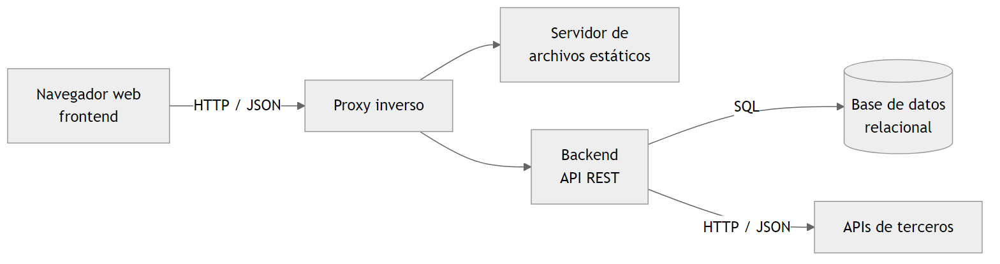{width=14cm}

Para el *backend* se eligió FastAPI, un *framework* basado Python orientado a la construcción de APIs. Se apoya en las anotaciones de tipos (typehints) para validar los datos de entrada y de salida, y genera de manera automática la documentación interactiva de la API bajo el estándar OpenAPI. Esto último, a su vez, permite generar automáticamente el código cliente (SDK) del *frontend*. 

Para el *frontend* se eligió React, una biblioteca de JavaScript para construir interfaces a partir de componentes reutilizables, junto con TypeScript, que agrega tipado estático al lenguaje. El entorno de desarrollo y de compilación del *frontend* se ejecuta sobre Node.js.

## 2.2. Virtualización ligera con contenedores

La virtualización permite ejecutar varios entornos aislados sobre un mismo equipo físico. En la virtualización tradicional, cada máquina virtual incluye un sistema operativo completo, lo que implica un consumo considerable de recursos. Los contenedores, en cambio, comparten el núcleo del sistema operativo anfitrión y aíslan únicamente los procesos, el sistema de archivos y la red de cada aplicación. Esto los hace más livianos de usar.

El aislamiento entre componentes aporta varias ventajas: cada servicio incluye sus propias dependencias sin interferir con las de los demás, el entorno de desarrollo es equivalente al de producción y la instalación en un equipo nuevo se reduce a pocos comandos.

Docker es una de las herramientas de contenedores más difundidas que hay. Una imagen de Docker se describe en un archivo de texto llamado *Dockerfile*, que indica la imagen base y los pasos necesarios para configurar el entorno. El sistema de archivos de un contenedor es efímero: los cambios se pierden cuando el contenedor se elimina. Por ese motivo, los datos que deben persistir, como los archivos de la base de datos, se almacenan en volúmenes alojados en el equipo anfitrión de Docker. Además, Docker Compose permite además, describir en un único archivo todos los contenedores de una aplicación, sus redes y sus volúmenes, y levantarlos en conjunto.

## 2.3. Tecnología RFID

La identificación por radiofrecuencia, o RFID por sus siglas en inglés, permite identificar objetos a distancia mediante ondas de radio. Un sistema RFID se compone de etiquetas, que almacenan un identificador, y de lectores, que las interrogan. En las etiquetas pasivas, como las tarjetas plásticas utilizadas en este proyecto, la energía necesaria para responder es provista por el campo electromagnético del propio lector, por lo que no requieren batería y su alcance es de pocos centímetros.

Las tarjetas utilizadas son las de 13,56 MHz. Cada tarjeta posee un número único grabado de fábrica y no se reescribe.

Los lectores empleados en las terminales de caja y de tapeo se conectan por USB y se comportan como un teclado: al acercar una tarjeta, el lector escribe su número seguido de la tecla Enter. Esta característica simplifica la integración con una aplicación web, ya que el navegador recibe la lectura como si el usuario la hubiera tipeado. Como contrapartida, cuando hay varios lectores conectados a un mismo equipo, el navegador no puede distinguir de cuál de ellos proviene una lectura. Este problema y su solución se tratan en la sección 3.5.

## 2.4. Sistema Vitte

Vitte es un sistema de dispensado de vino por copa compuesto por tres elementos: las máquinas dispensadoras, la aplicación que las controla y una plataforma en la nube. Se muestran en la Fig. 2.2.

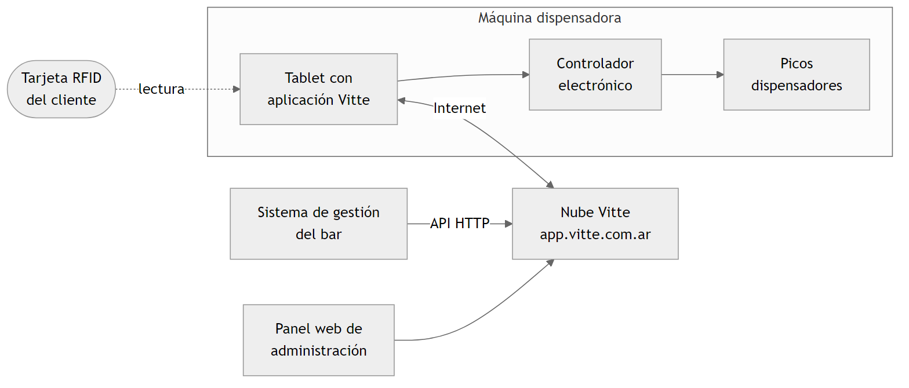{width=14.5cm}

### 2.4.1. Máquinas dispensadoras

Cada máquina es una cava refrigerada con varios picos dispensadores. Cada pico tiene asignada una botella y puede servir cualquiera de tres medidas: degustación, media copa y copa, cada configurable una con su volumen y su precio. Sobre la cava viene montada una tablet que ejecuta la aplicación de Vitte para Android y que se comunica con la electrónica que acciona los picos.

Para servirse, el cliente acerca su tarjeta a la máquina. La aplicación consulta la nube para verificar que la tarjeta pertenezca a un cliente activo y que su saldo alcance. Luego el cliente elige el vino y la medida, la máquina dispensa y el consumo queda registrado en la nube, descontado del saldo de esa tarjeta.

### 2.4.2. Nube

La plataforma en la nube concentra la información de la empresa: locales, máquinas, módulos, posiciones de cada pico, vinos, precios, clientes, tarjetas, saldos y consumos. Ofrece un panel web de administración y una API HTTP que utilizan tanto ese panel como las tablets de las máquinas.

El sistema del bar necesitaba conectarse con esa nube para dar de alta clientes, cargarles saldo y recuperar sus consumos. Sin embargo, al momento de realizar el trabajo no existía documentación pública de la API ni otro mecanismo de integración ofrecido por el fabricante. Para resolverlo, se utilizó Wireshark (un analizador de protocolos de red) y las herramientas de desarrollador del navegador instalado. Wireshark permitió capturar el tráfico que intercambian la tablet de la máquina con la nube. Desde las herramientas de desarrollador, se pudo observar el tráfico entre la aplicación web y su backend. De este análisis se obtuvieron las direcciones, los formatos de los mensajes y el mecanismo de autenticación de cada operación importante, que luego fueron emuladas en el sistema desarrollado. Las operaciones identificadas y utilizadas se resumen en la Tabla 2.1.

Table: Tabla 2.1: Operaciones de la API de Vitte utilizadas por el sistema.


| Operación | Uso en el sistema |
| ------------------------------- | -------------------------------------------------------------------- |
| Inicio de sesión | Obtención de un *token* de acceso, que se renueva cada hora |
| Locales del usuario | Obtención de los identificadores de empresa y de local |
| Máquinas, módulos y posiciones | Recorrido de los picos para conocer los vinos cargados y sus precios |
| Búsqueda de cliente por tarjeta | Verificación de existencia y consulta del saldo |
| Guardado de cliente | Alta, modificación e inhabilitación de un cliente |
| Borrado de cliente | Liberación de la tarjeta al cierre de la orden |
| Carga de saldo | Asignación del crédito disponible para consumir |
| Reporte de consumos | Recuperación de los consumos de vino de un período |
| Imagen de vino | Obtención de la imagen de cada vino |


Dos características de la plataforma condicionaron el diseño. La primera es que las máquinas operan con un esquema de saldo prepago, mientras que el bar requería un esquema pospago; por eso la necesidad de pre-cargarle saldo a la tarjeta. La segunda es que una tarjeta solo puede estar asociada a un cliente activo por vez; lo que obliga a dar de baja al cliente en Vitte cada vez que devuelve la tarjeta.

## 2.5. Sistema Fudo

Fudo es un sistema de gestión gastronómica en la nube, organizado alrededor de salones, mesas y ventas. El restaurante vinculado a Altacava lo utiliza para su operatoria diaria. Durante el desarrollo surgió la necesidad de que un cliente que consumió en el bar y luego pasa a una mesa del restaurante pudiera abonar todo junto. Para ello se utilizó la API pública de Fudo, que requiere una clave y un secreto de aplicación con los que se obtiene un *token* temporal. Las operaciones utilizadas son la consulta de salones, la consulta de mesas con sus ventas activas, la consulta del detalle de una venta y la creación de ítems dentro de una venta.

## 2.6. Requerimientos

Los requerimientos se relevaron en reuniones con el cliente durante la primera etapa del proyecto. El relevamiento inicial se plasmó en un documento de texto que sirvió como entrada para el diseño conceptual de la base de datos, y se fue ampliando a medida que el cliente probaba las versiones intermedias.

### 2.6.1. Requerimientos funcionales

Table: Tabla 2.2: Requerimientos funcionales.


| Id. | Descripción |
| ---- | ---------------------------------------------------------------------------------------------------------------------------------------------------------------------------------- |
| RF1 | Todas las personas, tanto clientes como personal, deben operar en el bar mediante tarjetas RFID. |
| RF2 | Cada tarjeta debe estar registrada con un rol (administrador, cajero, tapero o cliente) antes de asignarse a una persona. Debe conocerse si está activa, entregada y presente en el salón. |
| RF3 | El personal interno debe poder iniciar sesión acercando su tarjeta a la terminal. |
| RF4 | El administrador debe poder dar de alta y de baja tarjetas, personal y tapas, y configurar los montos máximos por defecto. |
| RF5 | El bar debe atender por turnos, abiertos y cerrados por un cajero. De cada turno debe registrarse la apertura, el cierre, la cantidad de órdenes y los montos cobrados. |
| RF6 | Al ingresar un cliente, el cajero debe registrarlo, entregarle una tarjeta y abrirle una orden de compra. |
| RF7 | El cliente debe poder servirse vino en las dispensadoras con la tarjeta recibida, sin intervención del personal. |
| RF8 | El tapero debe poder cargar pedidos de tapas a la orden del cliente a partir de su tarjeta. Cada pedido está formado por uno o más renglones con producto, cantidad y monto. |
| RF9 | El menú de vinos, con sus nombres, medidas y precios, debe obtenerse del sistema de las dispensadoras. |
| RF10 | Cada orden y cada pedido deben tener un monto máximo, tomado de una configuración general y modificable para una orden en particular. |
| RF11 | Los consumos de vino deben incorporarse a la orden del cliente junto con los de tapas. |
| RF12 | El cajero debe poder (i) consultar una orden usando la tarjeta o tipeando el nombre del cliente, (ii) cobrarla indicando los medios de pago y (iii) cerrarla. |
| RF13 | Debe poder emitirse el detalle de una orden en un formato imprimible. |
| RF14 | Debe poder cambiarse de cajero sin cerrar las órdenes en curso. |
| RF15 | Debe poder imputarse una orden a una venta abierta de una mesa de Fudo. |
| RF16 | El cliente debe poder ver su consumo acumulado en una pantalla en el puesto de tapas. |


Los requerimientos RF13 a RF16 no formaban parte del relevamiento inicial y se incorporaron durante el desarrollo. El relevamiento inicial preveía además un rol de cliente VIP, con condiciones de consumo diferenciadas. Ese requerimiento fue reemplazado por la posibilidad de ajustar los montos máximos de cada orden (RF10), que resuelve la misma necesidad de forma más simple. 

### 2.6.2. Requerimientos no funcionales

Table: Tabla 2.3: Requerimientos no funcionales.


| Id. | Descripción |
| ---- | -------------------------------------------------------------------------------------------------------------------------------------------- |
| RNF1 | El sistema debe funcionar dentro de la red local del bar y operarse desde un navegador web. |
| RNF2 | La información debe persistir ante reinicios y cortes de energía. |
| RNF3 | El sistema no debe eliminar tarjetas, personal ni clientes de la base de datos, para conservar la trazabilidad de las operaciones.  |
| RNF4 | La instalación y la actualización deben poder realizarse con un procedimiento simple y repetible. |
| RNF5 | La atención en el puesto de tapas debe ser ágil: cargar una tapa no debe requerir más que una acción. |
| RNF6 | El sistema debe informar con claridad el estado de la conexión con Vitte y no bloquearse cuando ese servicio no responde. |
| RNF7 | Solo el personal autenticado, y desde una terminal autorizada, debe poder operar. |


### 2.6.3. Restricciones

- Las máquinas dispensadoras, su aplicación y su nube son un sistema cerrado que no puede modificarse.
- Las tarjetas a utilizar son las que admiten las dispensadoras.
- Los consumos de vino solo pueden conocerse consultando la nube de Vitte, lo que exige conexión a Internet.
- El cliente definió que la app se alojara en una PC local.


## 2.7. Planificación


### 2.7.1. Plan de trabajo

La propuesta aprobada preveía seis semanas de trabajo: una de relevamiento de requisitos, una de planteo de la solución, tres de implementación y rediseño, y una de redacción del informe.

En la práctica, el desarrollo se extendió más allá de ese plan, ya que el sistema se puso en uso y el cliente solicitó funciones adicionales. La Tabla 2.4 resume las etapas reales, reconstruidas a partir del historial del repositorio de código.

Table: Tabla 2.4: Etapas del desarrollo según el historial del repositorio.


| Período                | Tareas principales                                                                                                               |
| ---------------------- | -------------------------------------------------------------------------------------------------------------------------------- |
| Febrero de 2024        | Relevamiento, modelos conceptual, lógico y físico de la base de datos, estructura inicial del *backend* y primeras migraciones   |
| Marzo de 2024          | Gestión de tarjetas, personal y clientes, pedidos y renglones, autenticación, primeras vistas del *frontend*, servidor de claves |
| Abril de 2024          | Lectores RFID y pantalla del cliente en la terminal de tapeo, integración con Vitte                                              |
| Mayo de 2024           | Sincronización de vinos y consumos, exportación de órdenes, asociación de lectores con tapas, configuración de montos            |
| Junio de 2024          | Despliegue con contenedores, cobro con desglose de pagos, cierre de caja, cambio de cajero, impresión de comandas                |
| Junio a agosto de 2024 | Integración con Fudo                                                                                                             |
| Septiembre de 2024     | Manejo de errores ante la falta de conexión con Vitte                                                                            |
| Junio de 2026          | Mejoras de tolerancia a fallas en la integración con Vitte                                                                       |


El trabajo se organizó en tareas identificadas con un código, cada una desarrollada en una rama propia del repositorio e integrada a la rama principal mediante una solicitud de integración. El código se distribuyó en tres repositorios: el *backend*, que además contiene la configuración del despliegue, el *frontend* y el servidor local de las terminales.

### 2.7.2. Análisis de riesgos

Al inicio del proyecto se identificaron los riesgos de la Tabla 2.5 y se definió una respuesta para cada uno, que puede ir desde reconocerlo hasta mitigarlo completamente.

Table: Tabla 2.5: Riesgos identificados y respuesta definida.

| Id. | Riesgo | Probabilidad | Impacto | Respuesta |
|:--|:------|:--|:--|:------|
| R1 | La API de Vitte no permite realizar alguna de las operaciones necesarias | Media | Alto | Reducir la probabilidad de descubrirlo tarde: probar cada operación con una prueba de concepto antes de desarrollar el resto del sistema. Como contingencia, realizar esa operación a mano desde el panel de Vitte |
| R2 | Vitte modifica su API sin aviso | Media | Alto | No puede evitarse. La forma de las respuestas de Vitte se validan contra los esquemas encontrados, de modo que un cambio sea capturado como un error y no como datos incorrectos. |
| R3 | Pérdida de conexión a Internet durante la atención | Media | Alto | App debe informar el estado de la conexión y evitar que las consultas que dependen de Internet, bloqueen el resto del sistema |
| R4 | Un cliente consume por encima de lo que puede o desea pagar | Media | Medio | Montos máximos por pedido y por orden |
| R5 | Un cliente se retira sin pagar, con la tarjeta en su poder | Baja | Medio | Riesgo aceptado por el cliente. El sistema permite detectarlo al final del turno, porque la orden queda abierta y el turno no puede cerrarse sin resolverla |
| R6 | Cambios de requerimientos con el sistema en uso | Alta | Medio | Migraciones versionadas de la base de datos y despliegue repetible |
| R7 | Pérdida de datos por falla del servidor | Baja | Alto | El sistema sube copias de seguridad periódicas a AWS S3. |
| R8 | Corte de energía mientras se arma un pedido | Media | Bajo | El carrito se guarda en la base de datos, como un pedido abierto. Al volver a identificar al cliente, el pedido se retoma donde había quedado |

# 3. Diseño e implementación

En este capítulo se describe la solución, de lo general a lo particular: los casos de uso, la arquitectura, las decisiones de autenticación y de red, la terminal de tapeo y, por último, el desarrollo del *backend* y del *frontend*.

## 3.1. Casos de uso


### 3.1.1. Actores

- Administrador: personal con acceso a la configuración del sistema.
- Cajero: personal a cargo de la caja y de la recepción de los clientes.
- Tapero: personal a cargo del puesto de tapas.
- Cliente: persona que consume en el bar. Actúa sobre el sistema únicamente mediante su tarjeta.
- Nube Vitte: sistema externo de las dispensadoras de vino.
- Fudo: sistema externo de gestión gastronómica.


### 3.1.2. Diagrama de contexto

La Fig. 3.1 muestra el sistema, los actores que interactúan con él y los sistemas y dispositivos externos con los que se comunica.

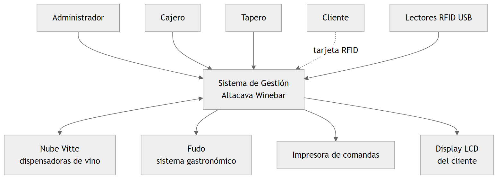{width=14cm}

### 3.1.3. Diagrama de casos de uso

La Fig. 3.2 muestra los casos de uso principales y los actores que participan en cada uno.

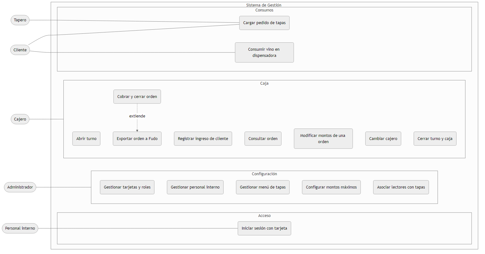{width=15.5cm}

### 3.1.4. Descripción de los casos de uso principales

A continuación se describen los casos de uso más relevantes para el funcionamiento del sistema.

Caso de uso: iniciar sesión con tarjeta.

- Actores: administrador, cajero, tapero.
- Precondición: la persona fue dada de alta y tiene una tarjeta de personal asignada. La terminal posee una clave de API configurada.
- Flujo principal: la persona acerca su tarjeta al lector. El sistema valida la tarjeta y la clave de la terminal, y habilita la vista correspondiente.
- Flujo alternativo: si la tarjeta no pertenece a personal activo o la terminal no es reconocida, el sistema informa el error y no permite operar.

Caso de uso: abrir turno.

- Actor: cajero.
- Precondición: el cajero inició sesión y no existe un turno abierto.
- Flujo principal: el cajero abre el turno. El sistema registra la fecha, la hora y el cajero que lo abrió.
- Postcondición: quedan habilitadas las operaciones de registro de clientes, carga de pedidos y cobro.

Caso de uso: registrar ingreso de cliente.

- Actor: cajero.
- Precondición: existe un turno abierto y hay conexión con Vitte.
- Flujo principal: el cajero ingresa el nombre del cliente y, opcionalmente, otros datos. Acerca al lector una tarjeta de cliente libre. El sistema crea el cliente, lo asocia con la tarjeta, abre una orden de compra con los montos máximos vigentes, da de alta al cliente en Vitte y le carga un saldo igual al monto máximo de la orden. El cajero entrega la tarjeta.
- Flujos alternativos: si la tarjeta no existe, no es de cliente o ya está en uso, el sistema rechaza la operación. Si Vitte no está disponible, el sistema no crea el cliente e informa el motivo.

Caso de uso: consumir vino en dispensadora.

- Actor: cliente.
- Precondición: el cliente posee una tarjeta con una orden abierta.
- Flujo principal: el cliente acerca la tarjeta a la dispensadora, elige vino y medida, y se sirve. El consumo queda registrado en la nube de Vitte. El sistema lo incorpora a la orden la próxima vez que esta sea consultada.

Caso de uso: cargar pedido de tapas.

- Actores: tapero, cliente.
- Precondición: el tapero inició sesión en la terminal de tapeo, existe un turno abierto y el cliente posee una orden abierta.
- Flujo principal: el cliente acerca la tarjeta al lector. El sistema muestra su nombre y abre un pedido. El tapero agrega las tapas solicitadas desde la pantalla, o bien el cliente acerca la tarjeta al lector ubicado junto a cada tapa. Al confirmar, el sistema cierra el pedido, suma su monto a la orden y muestra el resumen.
- Flujos alternativos: si al agregar un producto se supera el monto máximo del pedido o el de la orden, el sistema lo rechaza y deja el pedido como estaba. Si se identifica a otro cliente o se abandona la operación sin confirmar, el pedido queda abierto y se retoma cuando el cliente vuelve a acercar su tarjeta.

Caso de uso: cobrar y cerrar orden.

- Actor: cajero.
- Precondición: existe un turno abierto y el cliente posee una orden abierta.
- Flujo principal: el cliente devuelve la tarjeta. El cajero la acerca al lector. El sistema actualiza los consumos de vino y muestra el detalle y el total. El cajero indica cuánto se cobró en efectivo, con tarjeta y por transferencia, y confirma. El sistema verifica que la suma coincida con el total, cierra la orden, da de baja al cliente en Vitte y deja la tarjeta disponible para otro cliente.
- Flujo alternativo, exportar a Fudo: el cajero elige imputar la orden a una mesa. El sistema muestra las mesas de Fudo con ventas activas y el cajero selecciona una venta. El sistema crea en esa venta un ítem por cada producto consumido y cierra la orden dejando asentados el número de venta y de mesa.
- Flujo alternativo: si la suma de los pagos no coincide con el monto cargado, el sistema no cierra la orden.

Caso de uso: cerrar turno y caja.

- Actor: cajero.
- Precondición: existe un turno abierto y no quedan órdenes abiertas.
- Flujo principal: el cajero informa el monto contado en caja y, si lo desea, un comentario. El sistema cierra el turno y registra la cantidad de órdenes, los montos cobrados por cada medio de pago y la diferencia con lo informado.
- Flujo alternativo, cambiar cajero: si quedan clientes en el salón y debe cambiar el responsable de la caja, el sistema cierra el turno del cajero saliente, abre uno nuevo a nombre del entrante y traslada a este las órdenes abiertas.


## 3.2. Arquitectura propuesta

La solución se construyó con los bloques que muestra la Fig. 3.3 y que se describen a continuación.

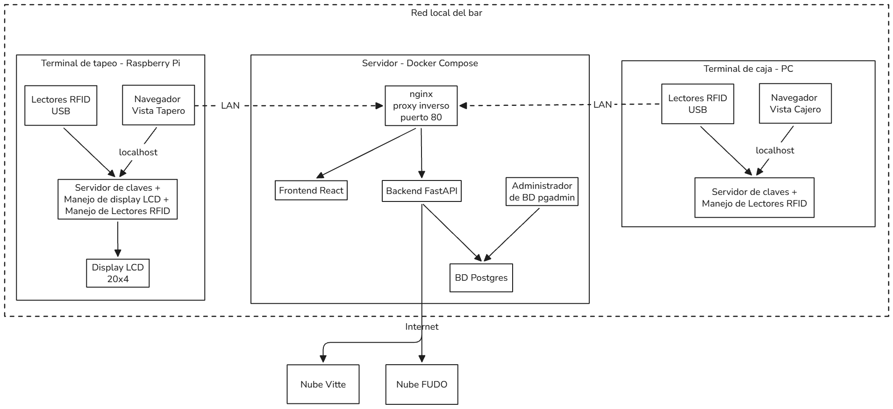{width=15cm}

En un servidor ubicado en el local se ejecutan, mediante Docker Compose, cinco contenedores conectados a una red interna:

- nginx: proxy inverso y único punto de entrada. Deriva las peticiones a la raíz hacia el *frontend* y las que comienzan con el prefijo del *backend* hacia la API.
- *frontend*: sirve la aplicación React.
- *backend*: ejecuta la API desarrollada con FastAPI.
- postgres: motor de base de datos PostgreSQL, con sus archivos en un volumen persistente.
- pgadmin: herramienta de administración de la base de datos, utilizada para tareas de soporte.

Todos los parámetros del despliegue, como nombres de contenedores, puertos, credenciales y claves, se definen en un único archivo de variables de entorno.

En cada puesto de trabajo hay una terminal con un navegador web y un pequeño servicio local, denominado servidor de claves. En la terminal de caja y en el puesto de administración, la terminal es una computadora personal con un lector RFID. En el puesto de tapas, la terminal es una Raspberry Pi a la que se conectan varios lectores RFID y un *display* LCD, y su servicio local cumple además las funciones que se describen en la sección 3.5.

Fuera de la red local, el *backend* se comunica por Internet con la nube de Vitte y con la API de Fudo. Las dispensadoras se comunican con la nube de Vitte de manera independiente.

## 3.3. Consideraciones de autenticación

El requerimiento de que el personal ingrese acercando su tarjeta plantea un problema: el número de una tarjeta identifica a la persona, pero no constituye un secreto en sí mismo; cualquiera que lo conozca podría tipearlo desde otro equipo de la red. Para resolverlo se combinaron dos factores: la tarjeta, que identifica a la persona, y una clave de API propia de cada terminal, que demuestra que la petición proviene de un puesto autorizado.

La clave de la terminal no se almacena en el navegador. La entrega un servicio que se ejecuta en la propia terminal y que solo es accesible desde ella: el servidor de claves. El flujo, que muestra la Fig. 3.4, es una adaptación del flujo de contraseña del estándar OAuth 2.0, en el que el número de tarjeta ocupa el lugar del nombre de usuario y la clave de la terminal el de la contraseña.

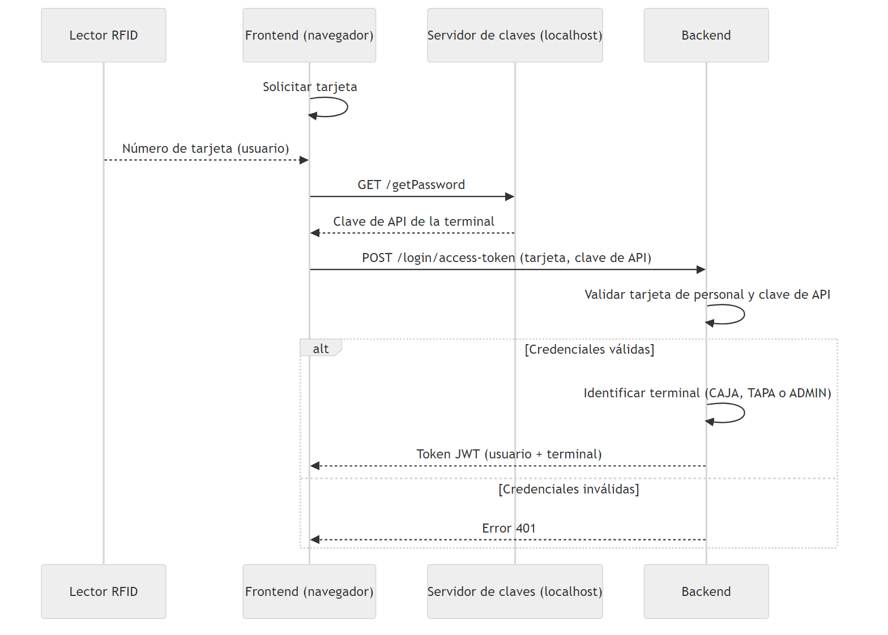{width=15cm}

Cuando las credenciales son válidas, el *backend* emite un *token* JWT que contiene el identificador de la tarjeta del usuario y el nombre de la terminal desde la que ingresó. El navegador lo envía en cada petición posterior. A partir de ese *token*, el *backend* resuelve dos cuestiones; usando el mecanismo de inyección de dependencias de FastAPI: quién es el usuario que opera, y desde qué terminal lo hace. El primero es dato un que se asienta en cada turno, orden y pedido, el segundo se usa para restringir ciertas operaciones a la terminal de tapeo.

El *backend* admite además un flujo convencional de usuario y contraseña, pensado para el acceso administrativo sin tarjeta. Los *tokens* emitidos por el flujo con tarjeta tienen una validez de doce horas, de modo que cubran un turno completo, mientras que los del flujo convencional vencen a los treinta minutos. Las contraseñas del personal se almacenan heasheadas.

## 3.4. Consideraciones de red

El sistema opera dentro de la red local del bar. El único puerto que el servidor expone a esa red es el del proxy inverso. El *backend*, el *frontend* y la base de datos solo son alcanzables a través de la red interna de contenedores. De esta manera, los puestos acceden a toda la aplicación desde una única dirección y se evitan los problemas de origen cruzado entre el *frontend* y la API.

El servidor de claves de cada terminal se consulta siempre en la dirección local del propio equipo. Esto implica que el navegador que muestra la aplicación debe ejecutarse en la misma máquina que el servicio, lo que constituye justamente la garantía buscada.

El servidor necesita salida a Internet para alcanzar la nube de Vitte y la API de Fudo, pero no requiere conexiones entrantes desde el exterior. Las dispensadoras utilizan su propia conexión con la nube del fabricante.

[COMPLETAR: topología real del local, es decir, equipo utilizado como servidor, direccionamiento, uso de red cableada o inalámbrica en cada puesto y mecanismo de acceso remoto para soporte, si lo hubiera.]

## 3.5. Consideraciones de la terminal de tapeo


### 3.5.1. Formas de uso esperadas

El puesto de tapas es el punto de mayor exigencia en cuanto a agilidad. Se previeron dos formas de uso, que pueden combinarse:

- Toma de pedido manual: el cliente se identifica con su tarjeta, indica verbalmente lo que desea y el tapero lo carga tocando las tapas en la pantalla.
- Toma de pedido por lector: junto a cada tapa exhibida hay un lector RFID. El cliente se identifica y luego acerca su tarjeta al lector de cada tapa que desea. Cada lectura agrega una unidad al pedido.

La terminal es una Raspberry Pi, y al encenderse inicia automáticamente el servidor local y el navegador a pantalla completa con la vista del tapero; mediante servicios del sistema operativo [COMPLETAR SISTEMA OPERATIVO].

### 3.5.2. Uso de lectores sin asociar

Como los lectores se comportan como teclados, cualquier lectura llega al navegador como texto, sin indicación de su origen. Si no se hace nada más, todos los lectores son equivalentes: sirven para identificar al cliente, y el tapero carga las tapas de forma manual. Este es el modo de uso básico y no requiere configuración alguna.

### 3.5.3. Uso de lectores con asociación

Para que una lectura pueda interpretarse como el pedido de una tapa, es necesario saber en qué lector se produjo. Esto se resolvió fuera del navegador. El servidor local de la Raspberry Pi accede a los dispositivos de entrada a través de la interfaz de eventos del sistema operativo. Ahí puede identificar los que corresponden a los lectores RFID [COMPLETAR LA CADENA QUE BUSCA] y lanza un hilo de ejecución que escucha a cada uno. Cada dispositivo informa el puerto USB físico al que está conectado, dato que permanece estable mientras el lector no se cambie de puerto.

El mecanismo completo, que se ilustra en la Fig. 3.5, funciona de la siguiente manera:

1. Al iniciar sesión el tapero, el *frontend* consulta al servidor local los puertos de los lectores conectados y se los informa al *backend*, que los registra para esa terminal, pisando cualquier listado anterior.
2. Desde la vista de administración, cada lector registrado puede asociarse con una tapa del menú, o dejarse sin asociar.
3. La primera lectura de una tarjeta identifica al cliente y abre o retoma su pedido.
4. El servidor local recuerda la última tarjeta leída en esa terminal. Cuando detecta una nueva lectura de esa misma tarjeta, publica un evento con el puerto físico del lector utilizado. El *frontend* recibe esos eventos mediante una conexión de eventos enviados por el servidor (Server-Side Events).
5. El *frontend* solicita al *backend* que agregue un producto indicando la tarjeta y el puerto. El *backend* busca la tapa asociada a ese par teminal-puerto y agrega al pedido una unidad de la tapa correspondiente.

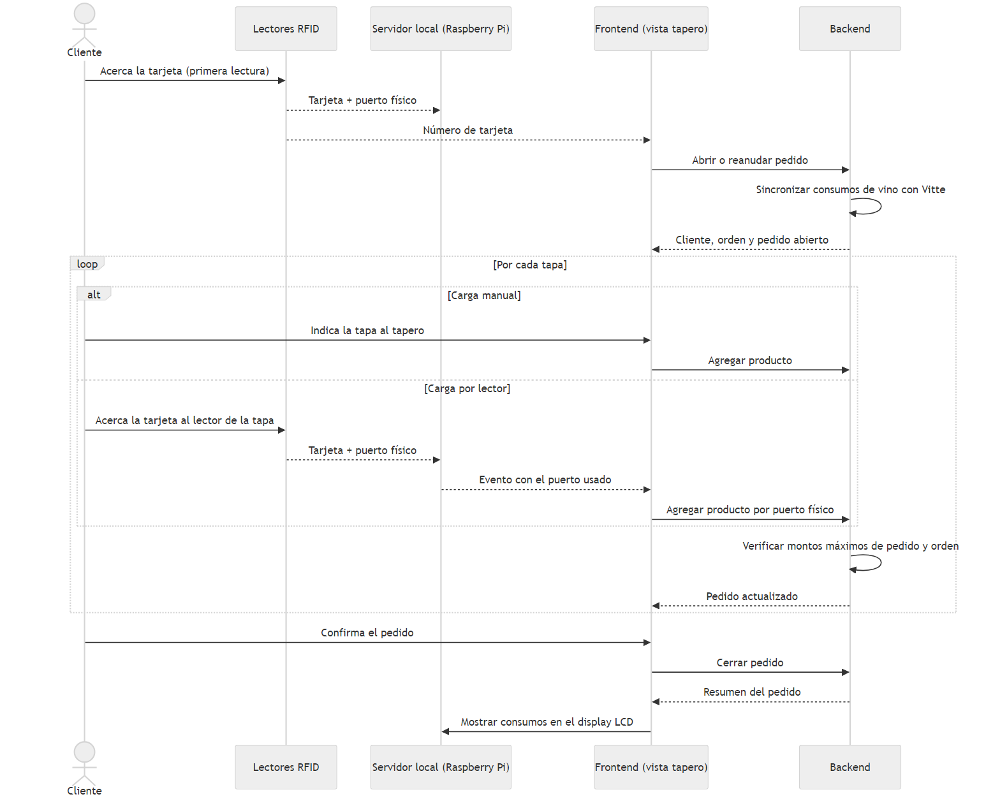{width=15cm}

Esta operación solo se acepta si el *token* de la sesión corresponde a una terminal de tapeo.

### 3.5.4. Display del cliente

El servidor local de la Raspberry Pi controla también un *display* LCD de cuatro líneas y veinte caracteres, conectado a los pines de propósito general de la placa y orientado hacia el cliente. Al confirmarse un pedido, el *frontend* envía al servidor local el nombre del cliente, el monto del pedido recién cargado y el consumo acumulado de su orden, que se muestran en el *display*. En reposo, se muestra un mensaje de bienvenida. La vista del tapero indica en su encabezado si el *display*, los lectores y la conexión con Vitte están disponibles.

## 3.6. Desarrollo del backend


### 3.6.1. Diseño de la base de datos

El diseño siguió las etapas clásicas. A partir del documento de requerimientos, se elaboró un modelo conceptual de entidades y relaciones. Para esto, se utilizó la herramienta CASER, provista en la carrera; que a partir de ese modelo deriva el modelo lógico y el modelo físico-. La Fig. 3.6 muestra el modelo resultante.

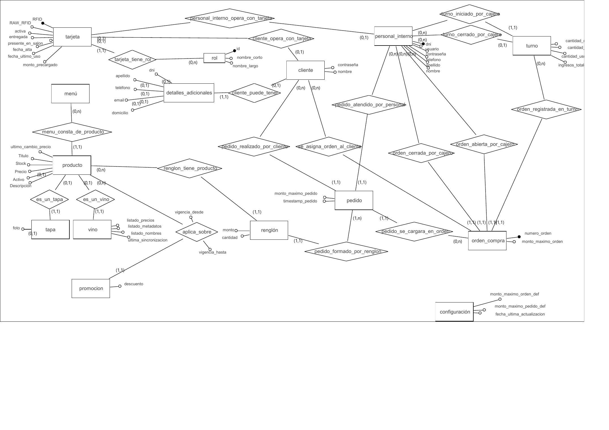{width=15.5cm}

El modelo se organiza en tres grupos de entidades:

- Tarjetas y usuarios: rol, tarjeta, cliente, detalles adicionales del cliente y personal interno. Cliente y personal interno surgen de una jerarquía total y exclusiva sobre la entidad persona. Los detalles adicionales se separaron del cliente porque son opcionales asumiendo que la mayoría de los clientes solo informará su nombre.
- Inventario y promociones: menú, producto, tapa, vino y promoción. Tapa y vino son especializaciones de producto.
- Gestión de pedidos: turno, orden de compra, pedido, renglón y configuración.

La estructura de turno, orden, pedido y renglón refleja el funcionamiento del bar. Un turno agrupa las órdenes atendidas entre una apertura y un cierre de caja. Una orden reúne todo lo consumido por un cliente durante su visita. Un pedido es cada una de las veces que el cliente hace un pedido, y un renglón es cada producto distinto dentro de un pedido, con su cantidad y su monto. Los montos máximos se copian desde la configuración a la orden y al pedido en el momento de su creación, de modo que un cambio posterior en la configuración no altere las órdenes en curso y que el límite de una orden particular pueda ajustarse sin afectar a las demás.

El modelo físico se implementó en PostgreSQL. Las tablas no se crearon con sentencias escritas a mano, sino a partir de clases definidas con el mapeador ORM SQLAlchemy, y cada modificación del esquema se registró como una migración con la herramienta Alembic. Al iniciar, el *backend* espera a que la base de datos esté disponible, aplica las migraciones pendientes y, si la base está vacía, crea los datos iniciales: los roles, un usuario administrador con su tarjeta y la configuración de montos por defecto. A lo largo del proyecto se acumularon 28 migraciones.

El esquema implementado mantiene la estructura del modelo original, con las diferencias que resume la Tabla 3.1, surgidas durante el desarrollo.

Table: Tabla 3.1: Diferencias entre el modelo diseñado y el esquema implementado.


| Elemento | Cambio | Motivo |
| ------------------------------------- | ------------------------------------------------------------------------------------------------------------------------------------------- | ------------------------------------------------------------------------- |
| Personal interno y tarjeta | La relación se implementó como una clave foránea en personal interno, en lugar de una tabla intermedia | Cada persona del personal tiene a lo sumo una tarjeta |
| Tarjeta, cliente, personal y producto | Se agregó un indicador de registro activo | Baja lógica en lugar de borrado físico |
| Cliente | Se agregó el nombre del rol utilizado | Conservar el dato histórico luego de devuelta/reutilizacion de la tarjeta |
| Vino | Se reemplazaron los listados de nombres, precios y metadatos por el identificador en Vitte y el volumen | Cada medida de cada vino se trata como un producto independiente |
| Orden de compra | Se agregaron el monto cargado, los montos cobrados por medio de pago, el monto imputado a Fudo, el monto máximo de pedido y los comentarios | Cobro con desglose, cierre de caja y exportación |
| Pedido | Se agregaron el estado de cerrado, el monto cargado y el indicador de exportación | Permitir pedidos en curso que se retoman |
| Renglón | Se agregó el identificador del consumo en Vitte | Evitar registrar dos veces un mismo consumo de vino |
| Turno | Se reemplazaron los ingresos totales por el monto en caja informado y se agregaron comentarios | Arqueo de caja |
| Lector de tapas | Tabla nueva | Asociación entre lectores RFID y tapas |


El modelo físico original y el listado de tablas se incluyen en el Anexo A.

### 3.6.2. Organización en capas

El *backend* se organizó en las capas que muestra la Fig. 3.7, aplicando principios de la orientación a objetos para separar responsabilidades.

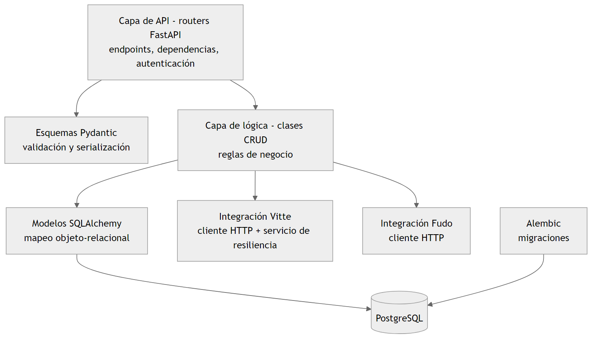{width=13cm}

- Modelos: clases que representan las tablas de la base de datos.
- Esquemas: clases que definen la forma de los datos que entran y salen de la API. Para cada entidad existen esquemas distintos de creación, de modificación y de respuesta, de modo que la API no expone la estructura interna de las tablas.
- Clases CRUD: concentran el acceso a los datos y las reglas de negocio. Una clase base genérica, parametrizada con el modelo y sus esquemas, implementa las operaciones comunes de alta, lectura, modificación y baja. Las clases de cada entidad heredan de ella y agregan su lógica propia.
- Enrutadores: definen los puntos de acceso de la API, declaran las dependencias de autenticación y de turno abierto, e invocan a las clases CRUD.

La baja lógica se resolvió con una segunda clase base, que hereda de la genérica y es utilizada por las entidades que poseen el indicador de registro activo. Esta clase implementa una sola vez los pasos comunes de tres operaciones: crear un registro, desactivarlo y reactivarlo. Lo que cambia de una entidad a otra, es decir, qué se verifica antes de cada operación y qué valores toma el registro después, queda en métodos que cada subclase redefine. Así, por ejemplo, la clase de tarjetas verifica que el rol exista y que la tarjeta no esté dada de alta antes de crearla, e impide desactivarla mientras esté entregada o presente en el salón. Si se da de alta una tarjeta que había sido dada de baja, el registro existente se reactiva en lugar de duplicarse o crease uno nuevo.

La API quedó organizada en los grupos de la Tabla 3.2. El listado completo de puntos de acceso se consulta en la documentación interactiva que genera el propio *backend*.

Table: Tabla 3.2: Grupos de puntos de acceso de la API.


| Grupo | Funciones |
| ---------------------------------- | ---------------------------------------------------------------------------------- |
| Login | Emisión de *tokens* y consulta del usuario autenticado |
| Roles, tarjetas y personal interno | Altas, bajas, consultas, entrega y devolución de tarjetas |
| Clientes | Alta de cliente con tarjeta y apertura de orden, consultas |
| Tapas y vinos | Gestión del menú de tapas y sus fotos, consulta de vinos |
| Turnos | Apertura, cierre, cambio de cajero y consultas |
| Órdenes | Consulta por tarjeta, nombre o turno, modificación de montos, cierre y exportación |
| Pedidos | Apertura, agregado y quita de productos, cierre y cancelación de renglones |
| Lectores de tapas | Registro de lectores por terminal y asociación con tapas |
| Configuración | Montos máximos por defecto |
| Vitte | Estado de la conexión |
| Fudo | Mesas, ventas por mesa y detalle de venta |


### 3.6.3. Lógica de pedidos y montos máximos

Cuando se agrega un producto, el *backend* busca una orden abierta asociada a la tarjeta y, dentro de ella, un pedido sin cerrar. Si no existe, lo crea. Si el producto ya figura en el pedido, incrementa la cantidad del renglón correspondiente. En caso contrario, crea un renglón nuevo. El monto del renglón se calcula a partir del precio vigente del producto. Luego se verifican los dos límites: la suma de los renglones del pedido no debe superar el monto máximo del pedido, y la suma de todos los pedidos de la orden no debe superar el monto máximo de la orden. Si alguno se supera, el agregado se revierte y se informa el motivo.

Al cerrar un pedido, se registran la fecha y hora, el usuario que lo atendió y el monto total, que se acumula en el monto cargado de la orden. Un renglón de un pedido ya cerrado puede cancelarse, en cuyo caso se descuenta su monto del pedido y de la orden.

### 3.6.4. Integración con Vitte

La integración se aisló en un módulo propio, compuesto por un cliente HTTP base que resuelve la autenticación y la renovación del *token*, clases para las operaciones sobre clientes y sobre vinos, esquemas que validan las respuestas, y funciones de sincronización con la base de datos. El resto del *backend* utiliza una única instancia de ese cliente.

El primer problema a resolver fue adaptar el esquema prepago de las dispensadoras al esquema pospago del bar. La solución consistió en utilizar el saldo de Vitte como un límite de crédito: al ingresar el cliente, se le carga un saldo igual al monto máximo de su orden. El cliente consume contra ese saldo sin haber pagado, y el importe a cobrar se determina a partir de los consumos efectivamente registrados (incluyendo las tapas). Si el cajero aumenta el monto máximo de una orden, el *backend* consulta el saldo actual en Vitte y carga la diferencia necesaria.

El ciclo de vida de un cliente en Vitte acompaña al de su orden, como muestran la Fig. 3.8 y la Fig. 3.9:

- En el ingreso, el *backend* verifica que la tarjeta no esté asignada a un cliente activo en Vitte, crea el cliente y le carga el saldo. Como nombre del cliente en Vitte se utiliza el id interno del cliente en el sistema, lo que permite luego reconocer sus consumos sin ambigüedad.
- Durante la visita, cada vez que se consulta la orden para tal cliente, el *backend* solicita a Vitte el reporte de consumos desde la apertura de la orden, selecciona los del cliente y, por cada consumo que aún no esté registrado, crea un pedido de un renglón con el vino y la medida correspondientes, conservando la fecha y la hora originales. El identificador del consumo se guarda en el renglón para no registrarlo dos veces.
- En la salida, luego del cobro, el *backend* inhabilita al cliente en Vitte: pone su saldo en cero, lo desvincula de la tarjeta y lo borra, con lo que la tarjeta queda libre para el próximo cliente.

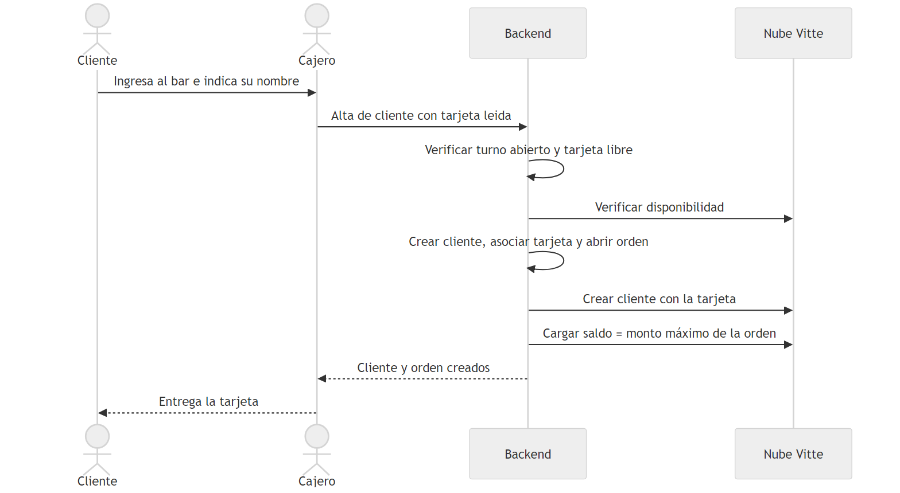{width=14.5cm}

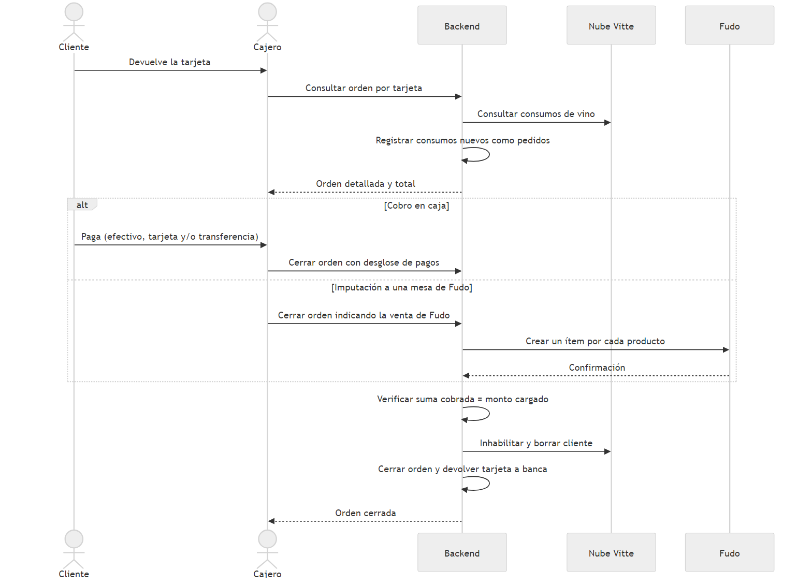{width=14.5cm}

Las tarjetas se identifican en el sistema por su número entero. Vitte, en cambio, espera el número tal como lo entrega el lector, incluidos los ceros iniciales. Por ese motivo, cada tarjeta conserva también su identificador sin procesar, que es el que se utiliza en todas las operaciones con Vitte.

El menú de vinos no se carga a mano. El *backend* recorre las máquinas, los módulos y las posiciones del local, y por cada pico con un vino asignado mantiene tres productos, uno por cada medida, con su volumen y su precio. Si en Vitte cambia el nombre o el precio de un vino, el producto correspondiente se actualiza.

#### Tolerancia a fallas

En la primera versión, cada consulta de una orden desencadenaba una sincronización completa con Vitte. Con el sistema en uso se observó que esto generaba dos inconvenientes: una demora perceptible en cada consulta y, cuando Vitte o la conexión a Internet fallaban, se bloqueaban operaciones que no dependían del vino. Para atenderlos, se incorporó un servicio entre el *backend* y el cliente de Vitte que aplica las siguientes medidas:

- Tiempos máximos de espera en todas las peticiones, de dos segundos para establecer la conexión y cinco para recibir la respuesta.
- Memoria temporal (caché) del estado de la conexión, que se reutiliza durante quince segundos.
- Limitación de la frecuencia de sincronización: el catálogo de vinos se sincroniza como máximo una vez cada treinta minutos, y los consumos de una misma tarjeta, una vez cada diez segundos.
- Exclusión mutua: si ya hay una sincronización en curso para una tarjeta, o del catálogo, las peticiones concurrentes no inician otra.
- Cortacircuitos: luego de tres fallas consecutivas, el servicio considera a Vitte fuera de línea y durante treinta segundos no realiza nuevos intentos, como muestra la Fig. 3.10.

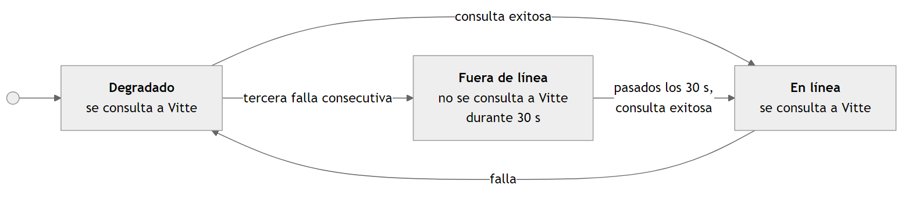{width=15cm}

Con este servicio, las operaciones se dividen en dos clases. Las que requieren Vitte, verifican el estado: el ingreso de un cliente, el cambio de montos máximos y el cierre de una orden. Si Vitte no está disponible, se rechazan de inmediato con un mensaje claro. Las consultas, en cambio, responden con la información disponible en la base de datos (la última sincronización) aunque no haya podido realizarse una nueva sincronización. El *backend* expone además el estado de la conexión, que el *frontend* consulta de manera periódica y muestra en el encabezado de las vistas.

[REVISAR: al momento de redactar este informe, estas mejoras se encuentran en una rama de pruebas del repositorio. Ajustar la redacción según su estado final en producción.]

### 3.6.5. Integración con Fudo

La integración con Fudo sigue la misma organización: un cliente HTTP que obtiene y renueva el *token* a partir de la clave y el secreto de la aplicación, esquemas para las respuestas y un conjunto de funciones que adaptan la información a lo que necesita el *frontend*.

Para imputar una orden a una mesa, el cajero ve el listado de mesas que tienen ventas activas, con el nombre del salón al que pertenecen, y al elegir una mesa ve sus ventas con la fecha de creación, la cantidad de personas, el nombre del cliente y el total. Seleccionada la venta, el *backend* agrupa los renglones de la orden por producto y crea en esa venta un ítem por cada producto distinto, con la cantidad y el monto acumulados.

Como los productos del bar no existen en el catálogo de Fudo, se definieron en Fudo dos artículos genéricos, uno para tapas y otro para vinos. Cada ítem exportado utiliza el artículo genérico que corresponde, con el precio informado por el sistema y un comentario que incluye el nombre real del producto, las notas del cajero y el número de orden. El cuerpo de la petición se genera a partir de una plantilla. Si la exportación falla, la orden no se cierra y el cajero puede reintentar. Si tiene éxito, la orden se cierra con el monto imputado a Fudo y un comentario generado automáticamente con el número de venta y de mesa. En el cierre de caja, estos montos se informan separados de los cobrados en efectivo, con tarjeta o por transferencia.

[COMPLETAR: capturas de la selección de mesa y de venta en la aplicación, de la venta de Fudo con los ítems exportados, del formulario de cobro con efectivo, tarjeta y transferencia, y del detalle de un turno cerrado con el desglose.]

### 3.6.6. Exportación de órdenes

El detalle de una orden puede exportarse en formato HTML o PDF. El documento se genera a partir de una plantilla, con un diseño ajustado al ancho de papel de la impresora de comandas del local, y se convierte a PDF mediante la herramienta wkhtmltopdf, incluida en la imagen del contenedor del *backend*.

## 3.7. Desarrollo del frontend

El *frontend* es una aplicación de una sola página desarrollada con React y TypeScript, con componentes visuales de la biblioteca React Bootstrap. Ofrece tres vistas (una por rol) que se seleccionan según la dirección a la que se accede.

El código que realiza las peticiones a la API no se escribió a mano. A partir de la especificación OpenAPI que publica el *backend*, una herramienta genera los servicios y los tipos de datos (un cliente SDK transpilado) en TypeScript. Cada vez que cambia la API, se vuelve a generar ese código. Esto reduce errores de integración entre ambas partes.

El desarrollo se organizó en componentes. Cada entidad administrable (por ejemplo Tapas en la Fig. 3.11) tiene un contenedor con su listado y sus formularios; y la lógica de cada formulario se extrajo a funciones reutilizables. El estado compartido se maneja con contextos: uno para la sesión, que guarda el *token* y los datos del usuario, y otro para el carrito de la vista del tapero, que mantiene el cliente identificado, su orden y el pedido en curso. Un componente común captura las lecturas de tarjeta y es reutilizado en el inicio de sesión, en el alta de clientes y en la identificación del cliente en el puesto de tapas.

La vista de administración, que muestra la Fig. 3.11, presenta un menú lateral con las secciones de personal, tarjetas, tapas, lectores, clientes, turnos, órdenes y configuración.

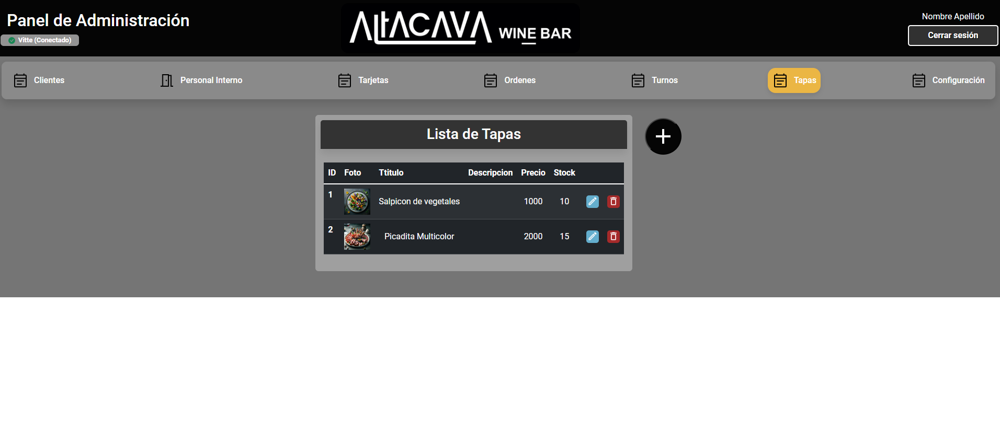{width=15cm}

La vista del cajero, que muestran la Fig. 3.12 y la Fig. 3.13, reúne en una sola pantalla las acciones frecuentes, un panel con el estado del turno y la búsqueda de órdenes por tarjeta o por nombre. El panel de cobro muestra los datos del cliente, los montos máximos, el monto cargado y el detalle de los pedidos, separados en vinos y tapas.

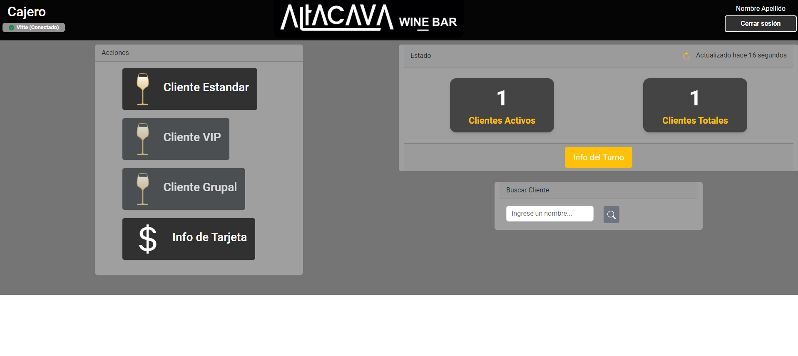{width=15cm}

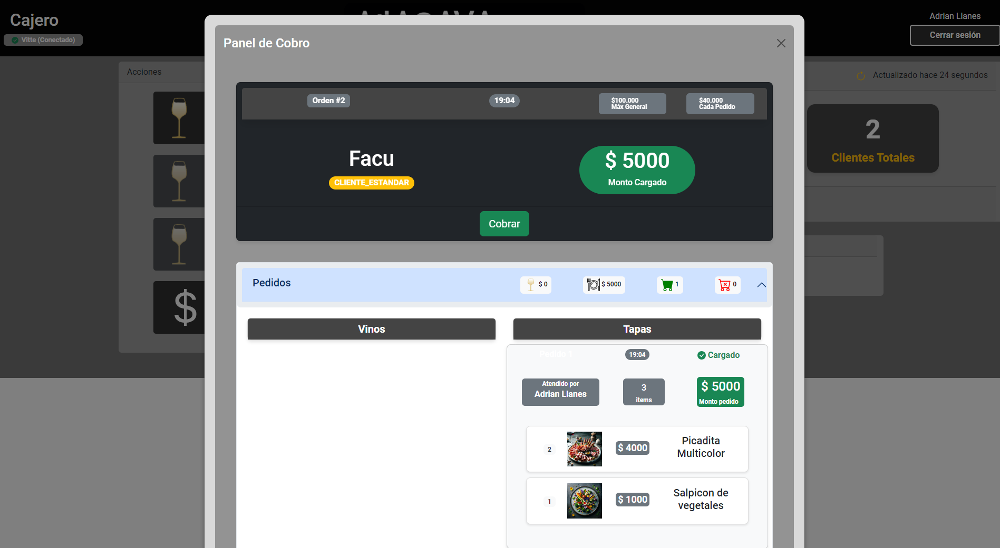{width=15cm}

La vista del tapero, que muestra la Fig. 3.14, está pensada para una pantalla táctil. Presenta el menú de tapas con sus fotos, el carrito del pedido en curso y un resumen con el nombre del cliente, el monto máximo del pedido y el subtotal. En el encabezado se indica el estado de la conexión con Vitte, de los lectores y de la pantalla del cliente.

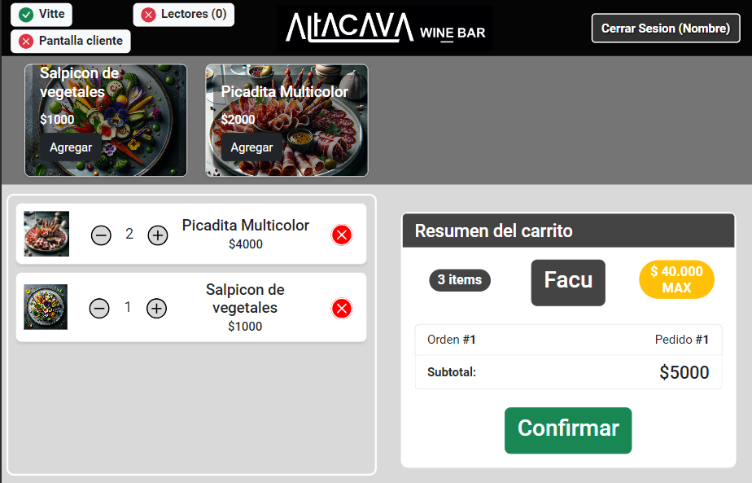{width=13cm}

# 4. Ensayos y resultados

En este capítulo se describen las pruebas realizadas, el seguimiento de los riesgos identificados y el grado de cumplimiento de los requerimientos.

## 4.1. Pruebas realizadas

[COMPLETAR/REVISAR: esta sección describe las pruebas que se desprenden del repositorio. Deben agregarse las pruebas efectivamente realizadas en el local, con fechas, participantes y resultados.]

Las pruebas se realizaron en tres niveles.

En primer lugar, pruebas unitarias de la capa de lógica, automatizadas con la herramienta pytest. Se cubrieron las operaciones sobre el personal interno, que ejercitan el mecanismo de alta, reactivación y baja lógica común a varias entidades.

En segundo lugar, pruebas de la API. La documentación interactiva generada por FastAPI se utilizó para ejercitar cada punto de acceso de forma aislada a medida que se desarrollaba. Para la integración con Fudo, se implementó una respuesta simulada de la operación de creación de ítems, que permitió probar el flujo completo de exportación sin impactar ventas reales, y la API de Fudo ofrece un entorno de pruebas para la autenticación. Para la integración con Vitte, no se dispuso de un entorno de pruebas, por lo que se trabajó contra la cuenta real del local con clientes y tarjetas destinados a ese fin.

En tercer lugar, pruebas de sistema en el local, con las dispensadoras, las terminales, los lectores y la impresora de comandas, recorriendo el flujo completo de un cliente: ingreso, consumo de vino, pedido de tapas y cobro. [COMPLETAR: detalle de estas pruebas y de la puesta en marcha.]

Table: Tabla 4.1: Casos de prueba de sistema.


| Caso                                             | Resultado esperado                                                                    | Resultado obtenido |
| ------------------------------------------------ | ------------------------------------------------------------------------------------- | ------------------ |
| Ingreso de un cliente con una tarjeta libre      | Se crea el cliente, se abre la orden y la tarjeta queda habilitada en la dispensadora | [COMPLETAR]        |
| Ingreso con una tarjeta ya entregada             | El sistema rechaza la operación                                                       | [COMPLETAR]        |
| Consumo de vino y posterior consulta de la orden | El consumo aparece como un pedido de la orden, con su hora original                   | [COMPLETAR]        |
| Agregado de una tapa que supera el monto máximo  | El sistema rechaza el agregado y conserva el pedido                                   | [COMPLETAR]        |
| Carga de una tapa mediante un lector asociado    | Se agrega una unidad de la tapa asociada                                              | [COMPLETAR]        |
| Cobro con suma de pagos distinta del total       | El sistema no cierra la orden                                                         | [COMPLETAR]        |
| Cierre de orden                                  | La tarjeta queda libre y deja de funcionar en la dispensadora                         | [COMPLETAR]        |
| Exportación de una orden a una mesa de Fudo      | Los ítems aparecen en la venta elegida y la orden queda cerrada                       | [COMPLETAR]        |
| Cierre de turno con órdenes abiertas             | El sistema lo impide e informa la cantidad de clientes activos                        | [COMPLETAR]        |
| Cambio de cajero con clientes en el salón        | Las órdenes abiertas pasan al nuevo turno                                             | [COMPLETAR]        |
| Pérdida de conexión con Vitte                    | El sistema indica el estado, rechaza los ingresos y permite seguir cargando tapas     | [COMPLETAR]        |


## 4.2. Seguimiento de los riesgos

La Tabla 4.2 resume lo ocurrido con cada uno de los riesgos identificados en la planificación.

Table: Tabla 4.2: Seguimiento de los riesgos.


| Id. | Qué ocurrió                                                                                                             | Respuesta                                                     |
| --- | ----------------------------------------------------------------------------------------------------------------------- | ------------------------------------------------------------- |
| R1  | Todas las operaciones necesarias pudieron realizarse. El esquema prepago de Vitte no coincidía con el pospago requerido | Uso del saldo como límite de crédito                          |
| R2  | [COMPLETAR: indicar si hubo cambios en la API de Vitte durante el período de uso]                                       | Integración aislada en un módulo                              |
| R3  | Se materializó: las fallas de conexión demoraban o bloqueaban operaciones                                               | Servicio de tolerancia a fallas descripto en la sección 3.6.4 |
| R4  | Los montos máximos se utilizaron desde la primera versión                                                               | Se agregó la posibilidad de modificarlos por orden            |
| R5  | [COMPLETAR]                                                                                                             | Bloqueo del cierre de turno con órdenes abiertas              |
| R6  | Se materializó: se incorporaron el desglose de pagos, el cambio de cajero, las comandas y la integración con Fudo       | Migraciones versionadas y despliegue con contenedores         |
| R7  | [COMPLETAR]                                                                                                             | [COMPLETAR]                                                   |


## 4.3. Cumplimiento de los requerimientos

Table: Tabla 4.3: Estado de los requerimientos funcionales.


| Id.  | Estado                | Observaciones                                                                      |
| ---- | --------------------- | ---------------------------------------------------------------------------------- |
| RF1  | Cumplido parcialmente | Los cinco roles existen. Los clientes operan solo con tarjetas de cliente estándar |
| RF2  | Cumplido              |                                                                                    |
| RF3  | Cumplido              |                                                                                    |
| RF4  | Cumplido              |                                                                                    |
| RF5  | Cumplido parcialmente | Las cantidades de tapas vendidas y de clientes VIP por turno no se calculan        |
| RF6  | Cumplido              |                                                                                    |
| RF7  | Cumplido              |                                                                                    |
| RF8  | Cumplido              |                                                                                    |
| RF9  | Cumplido              |                                                                                    |
| RF10 | Cumplido              |                                                                                    |
| RF11 | Cumplido              | Los consumos se incorporan al consultar la orden                                   |
| RF12 | Cumplido              |                                                                                    |
| RF13 | Cumplido              |                                                                                    |
| RF14 | Cumplido              |                                                                                    |
| RF15 | Cumplido              |                                                                                    |
| RF16 | Cumplido              |                                                                                    |


[COMPLETAR: resultados de uso real, si se desea incluirlos, como fecha de inauguración, cantidad de turnos y de órdenes procesadas, y opinión del cliente.]

# 5. Integración

En este capítulo se describe cómo se integraron en el trabajo las áreas de conocimiento de la carrera.

[REVISAR: ajustar los nombres de las áreas a los de las asignaturas de la EITI que correspondan.]

Bases de datos. El trabajo recorrió el proceso completo de diseño: relevamiento de requerimientos, modelo conceptual de entidades y relaciones, derivación de los modelos lógico y físico con la herramienta utilizada en la carrera, e implementación en un motor relacional. Se aplicaron los conceptos de jerarquías, cardinalidades, claves foráneas y normalización, y se resolvió la evolución del esquema mediante migraciones versionadas.

Programación orientada a objetos. La arquitectura del *backend* se basa en la separación de responsabilidades entre capas. La herencia y las clases genéricas permitieron implementar una sola vez las operaciones comunes a todas las entidades, y la redefinición de métodos en las subclases permitió especializar las reglas de cada una. Los clientes de Vitte y de Fudo encapsulan los detalles de cada servicio externo detrás de una interfaz propia.

Integración con sistemas externos. La interoperabilidad con la nube de Vitte requirió investigar una API no documentada, comprender su modelo de datos y adaptar un esquema de funcionamiento prepago a uno pospago. La integración con Fudo requirió, en cambio, trabajar con una API pública y resolver la falta de correspondencia entre los catálogos de productos de ambos sistemas. En los dos casos se aplicaron autenticación mediante *tokens*, validación de respuestas y manejo de fallas.

Redes y sistemas distribuidos. La solución es un sistema distribuido en pequeña escala: un servidor, terminales con servicios locales, dispositivos periféricos y servicios en la nube. Se aplicaron conceptos de protocolos de aplicación, proxy inverso, segmentación de redes mediante la red interna de contenedores, y patrones de tolerancia a fallas como los tiempos máximos de espera y el cortacircuitos.

Virtualización. El despliegue mediante contenedores permitió que el entorno de desarrollo y el de producción fueran equivalentes y que la instalación fuera repetible.

Hardware e integración con dispositivos. La terminal de tapeo integra una computadora de placa única con lectores RFID por USB y un *display* conectado a sus pines de propósito general, controlados desde un servicio propio.

Seguridad. Se diseñó un esquema de autenticación de dos factores adaptado a las condiciones del local, con *tokens* firmados y contraseñas almacenadas como resúmenes criptográficos.

Ingeniería de software y gestión de proyectos. Se relevaron y documentaron requerimientos, se modelaron casos de uso, se identificaron riesgos y se trabajó con control de versiones, ramas por tarea e integración mediante revisiones, en un desarrollo iterativo con entregas frecuentes al cliente.

# 6. Conclusiones


## 6.1. Resultados obtenidos

Se desarrolló un sistema de gestión de ventas para Altacava Winebar que cumple con el objetivo general planteado. Respecto de los objetivos específicos:

- Se desarrolló una aplicación web con vistas para el administrador, el cajero y el tapero, que permite gestionar las ventas del bar desde el ingreso del cliente hasta el cierre de caja.
- Se investigó el funcionamiento de la API de las dispensadoras Vitte y se la integró al sistema. La integración cubre el alta y la baja de clientes, la carga de saldo, la sincronización del menú de vinos y la recuperación de consumos.
- Las tarjetas RFID de las dispensadoras se reutilizaron para identificar a los clientes en el puesto de tapas y en la caja, y al personal en todas las terminales.
- Se diseñó e implementó una base de datos relacional siguiendo las etapas de modelado conceptual, lógico y físico, cuyo esquema evolucionó de manera controlada a lo largo del proyecto.

Además de lo previsto, se incorporaron funciones solicitadas por el cliente durante el desarrollo: el cobro con desglose por medio de pago, el cambio de cajero, la impresión de comandas, la carga de tapas mediante lectores asociados, la pantalla del cliente y la imputación de órdenes a mesas de Fudo.

[COMPLETAR: valoración del resultado por parte del cliente y estado actual de uso del sistema.]

El aprendizaje más significativo del trabajo se relaciona con la dependencia de un sistema externo. La integración con Vitte fue a la vez el aporte central del proyecto y su principal fuente de fragilidad. La experiencia mostró que no alcanza con que la integración funcione en condiciones normales: es necesario diseñar desde el inicio qué hace el sistema cuando el servicio externo demora o no responde.

## 6.2. Trabajo futuro

A partir de los puntos de dolor presentados, las siguientes características son deseables a futuro:

- Mejorar la cobertura de la red inalámbrica del local, de la que dependen las terminales y las dispensadoras. Con el tiempo, fueron compartiendo el acceso a WiFi con más dispositivos; y hoy en día funciona de forma muy inestable.
- Lograr que el sistema quede operativo sin intervención manual después de un reinicio del servidor, por ejemplo luego de un corte de energía. El local es grande y funciona en una planta baja, mientras que el servidor está en un primer piso. Cualquier interacción física con el servidor, ofrece mucha fricción. Más aun cuando el bar está operando.
- Reducir la dependencia de la conexión a Internet: registrar los consumos de vino mediante una tarea periódica, independiente de las consultas del cajero, y permitir que la caja siga operando en un modo degradado mientras Vitte no está disponible.
- Fijar las versiones de las dependencias y de las imágenes de los contenedores, para que una reinstalación no incorpore cambios incompatibles.
- Simplificar la aplicación en función del uso real. El local evolucionó hacia un esquema mixto, con mozos además del autoservicio, y el puesto de tapas perdió la relevancia que el cliente preveía al principio.
- Extender el modelo para administrar múltiples sucursales, en línea con el proyecto de largo plazo del cliente.

# Referencias bibliográficas

[COMPLETAR: fecha de consulta de cada página web y referencias adicionales utilizadas.]

1. Elmasri, R. & S. Navathe, *Fundamentos de Sistemas de Bases de Datos*, Pearson Educación, Madrid, 2007.
2. Sommerville, I., *Ingeniería de Software*, Pearson Educación, México, 2011.
3. Finkenzeller, K., *RFID Handbook*, John Wiley & Sons, Chichester, 2010.
4. Nygard, M., *Release It! Design and Deploy Production-Ready Software*, The Pragmatic Bookshelf, Raleigh, 2018.
5. Vitte, [https://vittewine.com/es-ar](https://vittewine.com/es-ar), [fecha de consulta].
6. Fudo, documentación para desarrolladores, [https://dev.fu.do](https://dev.fu.do), [fecha de consulta].
7. FastAPI, documentación oficial, [https://fastapi.tiangolo.com](https://fastapi.tiangolo.com), [fecha de consulta].
8. React, documentación oficial, [https://react.dev](https://react.dev), [fecha de consulta].
9. PostgreSQL, documentación oficial, [https://www.postgresql.org/docs](https://www.postgresql.org/docs), [fecha de consulta].
10. SQLAlchemy, documentación oficial, [https://docs.sqlalchemy.org](https://docs.sqlalchemy.org), [fecha de consulta].
11. Alembic, documentación oficial, [https://alembic.sqlalchemy.org](https://alembic.sqlalchemy.org), [fecha de consulta].
12. Docker, documentación oficial, [https://docs.docker.com](https://docs.docker.com), [fecha de consulta].
13. nginx, documentación oficial, [https://nginx.org/en/docs](https://nginx.org/en/docs), [fecha de consulta].
14. The OAuth 2.0 Authorization Framework, RFC 6749, [https://datatracker.ietf.org/doc/html/rfc6749](https://datatracker.ietf.org/doc/html/rfc6749), [fecha de consulta].
15. JSON Web Token (JWT), RFC 7519, [https://datatracker.ietf.org/doc/html/rfc7519](https://datatracker.ietf.org/doc/html/rfc7519), [fecha de consulta].
16. Raspberry Pi, documentación oficial, [https://www.raspberrypi.com/documentation](https://www.raspberrypi.com/documentation), [fecha de consulta].


# Anexo A. Modelo físico de la base de datos

Modelo físico derivado del modelo conceptual con la herramienta CASER. Las claves primarias se indican en mayúsculas.

- Rol (ID, nombre_corto, nombre_largo)
- Tarjeta (RFID, id, activa, fecha_alta, fecha_ultimo_uso, entregada, raw_rfid, presente_en_salon, monto_precargado)
- Menú (ID_MENÚ)
- Producto (ID_PRODUCTO, id_menú, titulo, descripción, precio, ultimo_cambio_precio, activo, stock)
- Tapa (ID_PRODUCTO, foto)
- Vino (ID_PRODUCTO, listado_nombres, listado_precios, listado_metadatos, ultima_sincronizacion)
- Promocion (ID_PROMOCION, id_producto, descuento)
- Cliente (ID_CLIENTE, nombre, contraseña)
- Detalles_adicionales (ID_CLIENTE, dni, apellido, email, teléfono, domicilio)
- Cliente_opera_con_tarjeta (ID_CLIENTE_OPERA_CON_TARJETA, id_cliente, rfid)
- Personal_interno (DNI, usuario, nombre, contraseña, apellido, telefono, id_turno)
- Personal_interno_opera_con_tarjeta (ID_PERSONAL_INTERNO_OPERA_CON_TARJETA, dni, rfid)
- Turno (ID_TURNO, cantidad_de_ordenes, cantidad_tapas, cantidad_usuarios_vip, ingresos_totales, id_personal_interno)
- Orden_compra (NUMERO_ORDEN, id_turno, monto_maximo_orden, id_cliente, id_personal_interno)
- Pedido (ID_PEDIDO, timestamp_pedido, monto_maximo_pedido, id_orden_compra, id_cliente, id_personal_interno)
- Renglón (ID_RENGLÓN, id_pedido, cantidad, monto, id_producto)
- Configuración (ID_CONFIGURACIÓN, monto_maximo_orden_def, monto_maximo_pedido_def, fecha_ultima_actualizacion)

Tablas del esquema implementado: roles, tarjetas, clientes, cliente_detalles_adicionales, clientes_y_tarjetas, personal_interno, menues, productos, tapas, tragos, vinos, promociones, productos_y_promociones, turnos, ordenes, pedidos, renglones, configuraciones y lectorestapas.

# Glosario

- API: interfaz de programación de aplicaciones.
- *Backend*: parte de una aplicación que se ejecuta en el servidor.
- Comanda: comprobante interno con el detalle de un pedido.
- CRUD: operaciones de alta, lectura, modificación y baja sobre una entidad.
- *Frontend*: parte de una aplicación que se ejecuta en el navegador.
- JWT: *JSON Web Token*, formato de *token* firmado.
- Orden de compra: conjunto de todos los consumos de un cliente durante una visita.
- Pedido: cada una de las solicitudes de productos que integran una orden.
- Pico: boca de salida de una dispensadora, asociada a una botella.
- Renglón: línea de un pedido, con un producto, una cantidad y un monto.
- RFID: identificación por radiofrecuencia.
- Tapero: persona que despacha las tapas.
- *Token*: credencial temporal que acredita una sesión.
- Turno: período comprendido entre una apertura y un cierre de caja.

